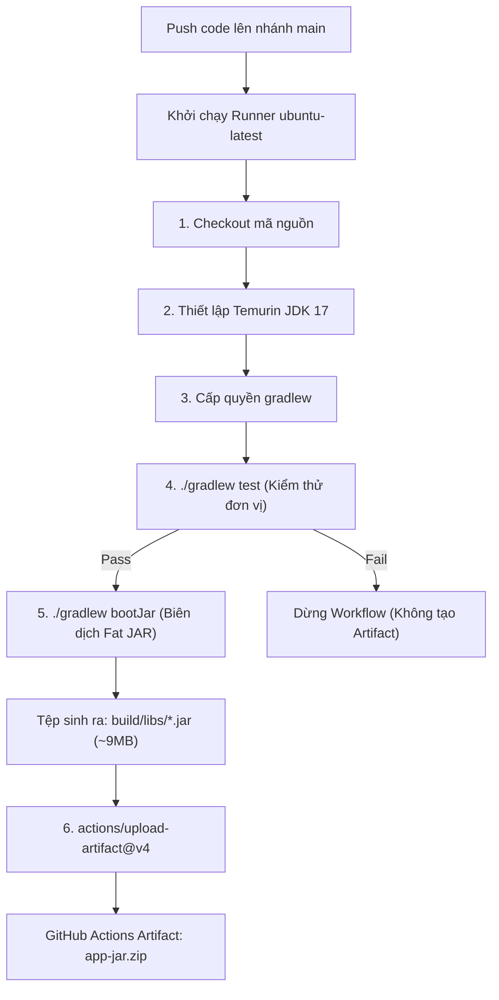

# Báo cáo Kỹ thuật: Biên dịch đóng gói tệp ứng dụng .jar với Gradle và lưu trữ Artifacts

## 1. Mục tiêu bài thực hành
- Thực hiện biên dịch mã nguồn và đóng gói ứng dụng Spring Boot hoàn chỉnh thành tệp thực thi `.jar` bằng Gradle task `bootJar`.
- Nắm vững kiến trúc đóng gói Fat JAR (Uber JAR) của Spring Boot và sự khác nhau giữa task `bootJar` và task `jar` truyền thống.
- Cấu hình lưu trữ tệp `.jar` sinh ra từ thư mục `build/libs/` lên hạ tầng lưu trữ Artifacts của GitHub Actions bằng action chính thức `actions/upload-artifact@v4`.
- Cho phép người dùng và các quy trình CI/CD downstream có thể truy cập, tải về và kiểm tra thành phẩm trực tiếp từ giao diện GitHub.

---

## 2. Kịch bản GitHub Actions Workflow (`.github/workflows/ci.yml`)

```yaml
name: Java Spring Boot CI (Gradle)

on:
  push:
    branches: [ "main" ]

jobs:
  test:
    name: Run Unit Tests
    runs-on: ubuntu-latest

    steps:
      - name: Checkout mã nguồn
        uses: actions/checkout@v5

      - name: Thiết lập môi trường Java JDK 17
        uses: actions/setup-java@v5
        with:
          java-version: '17'
          distribution: 'temurin'

      - name: Cấp quyền cho Gradle Wrapper
        run: chmod +x gradlew

      - name: Thực thi JUnit Test với Gradle
        run: ./gradlew test

      - name: Đóng gói tệp JAR với Gradle
        run: ./gradlew bootJar

      - name: Lưu trữ thành phẩm JAR Artifact
        uses: actions/upload-artifact@v4
        with:
          name: app-jar
          path: build/libs/*.jar
```

---

## 3. Phân tích Kỹ thuật chuyên sâu

### 3.1. Sự khác biệt giữa `bootJar` và `jar` trong Spring Boot Gradle Plugin
| Tiêu chí | Task `jar` (Java Plugin chuẩn) | Task `bootJar` (Spring Boot Plugin) |
| :--- | :--- | :--- |
| **Bản chất** | Thin JAR (Chỉ chứa bytecode lớp tự viết) | Fat JAR / Uber JAR (Đóng gói kèm toàn bộ runtime dependencies) |
| **Embedded Web Server** | Không có Tomcat/Jetty nhúng | Nhúng sẵn Tomcat, khởi chạy độc lập không cần cài server rời |
| **Khả năng thực thi** | Thường yêu cầu khai báo `classpath` bên ngoài | Khởi chạy trực tiếp: `java -jar app.jar` |
| **Spring Boot Loader** | Không tích hợp | Chứa `org.springframework.boot.loader.launch.JarLauncher` điều phối nạp thư viện từ `BOOT-INF/lib/` |

### 3.2. Cơ chế lưu trữ Artifact với `actions/upload-artifact@v4`
- **Quá trình nén & truyền tải:** Action v4 sử dụng giao thức truyền tải nén mới trực tiếp từ runner lên GitHub Blob Storage, tăng tốc độ tải lên gấp 2-3 lần so với phiên bản v3 trước đây.
- **Tên định danh (`name: app-jar`):** Định danh duy nhất để người dùng tải về dưới dạng file `app-jar.zip` hoặc để các job tiếp theo sử dụng `actions/download-artifact@v4` tải về.
- **Mẫu đường dẫn (`path: build/libs/*.jar`):** Sử dụng glob pattern để bắt bất kỳ tệp đuôi `.jar` nào được sinh ra trong thư mục đầu ra của Gradle.

---

## 4. Sơ đồ quy trình thực thi (Mermaid Diagram)



---

## 5. Nhật ký thực thi đóng gói cục bộ (Local Terminal Log)

Lệnh thực thi kiểm tra đóng gói trên máy phát triển:
```text
$ ./gradlew test && ./gradlew bootJar

> Task :compileJava UP-TO-DATE
> Task :processResources UP-TO-DATE
> Task :classes UP-TO-DATE
> Task :compileTestJava UP-TO-DATE
> Task :processTestResources NO-SOURCE
> Task :testClasses UP-TO-DATE
> Task :test
BUILD SUCCESSFUL in 2s

> Task :compileJava UP-TO-DATE
> Task :processResources UP-TO-DATE
> Task :classes UP-TO-DATE
> Task :resolveMainClassName
> Task :bootJar

BUILD SUCCESSFUL in 529ms
4 actionable tasks: 2 executed, 2 up-to-date
```

Kiểm tra tệp tin sau khi biên dịch:
```text
$ ls -la build/libs
total 17784
drwxr-xr-x@  3 trongtri  staff       96 Oct 14 19:38 .
drwxr-xr-x@ 10 trongtri  staff      320 Oct 14 19:38 ..
-rw-r--r--@  1 trongtri  staff  9102236 Oct 14 19:38 devops-ss11-hw02-0.0.1-SNAPSHOT.jar
```

Dung lượng tệp JAR đạt ~9.1 MB, chứng minh toàn bộ thư viện phụ thuộc (Spring Core, Spring Boot Autoconfigure, Logging Framework) đã được nhúng hoàn chỉnh.

---

## 6. Hướng dẫn kiểm tra và minh chứng trên GitHub Actions

### Các bước kiểm tra:
1. Truy cập vào kho lưu trữ: `https://github.com/ChongChi-hub/IT209_Session_11_Bai_02`.
2. Vào tab **Actions** -> Chọn workflow run mới nhất.
3. Chờ lượt chạy hoàn thành tích xanh.
4. Cuộn xuống phần **Summary** ở cuối trang giao diện tổng quan.
5. Kiểm tra mục **Artifacts**, xác nhận tệp `app-jar` xuất hiện với dung lượng tương ứng và có thể bấm nút tải xuống.

### Ảnh chụp màn hình minh chứng:
> *(Dán ảnh chụp màn hình phần Summary trên tab Actions hiển thị tệp artifact app-jar vào vị trí dưới đây)*

`ImgEx`
